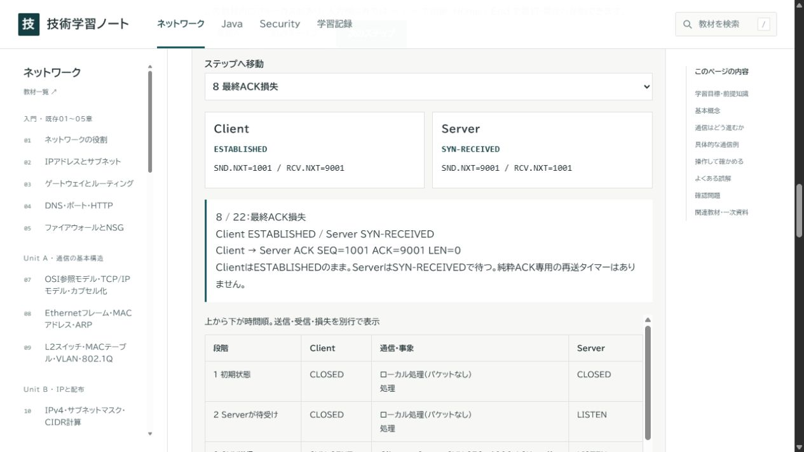
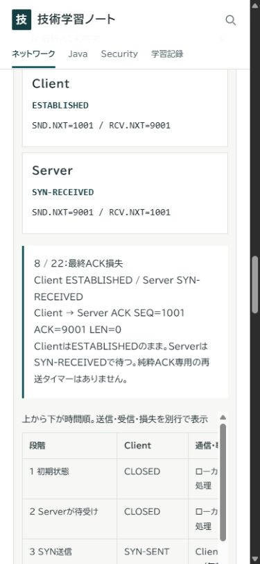

# Network Phase 3：実装・検証結果

実施日：2026-11-11（Asia/Tokyo）。対象：ローカル `E:\work\Study\technical-notes`。公開・Commit・Push・Git履歴/Author/Committer設定の変更は行っていない。

## 実装結果

|項目|結果|
|---|---|
|既存Network|6講義・23問・3ミッション・14参考回答・5復習語を原本どおり保持|
|新規Network|Unit A〜F、07〜24章の18講義、各3問で54問|
|合計Network|24講義・77講義確認問題・7ミッション。新規ミッションの判断問題12問は77に含めず別計上|
|新規ミッション|M4サブネット / M5 TCP / M6 VLAN・経路・NAT / M7障害切り分け。各3自由記述と参考回答、3判断問題と全選択肢理由|
|操作教材|8種：サブネット、VLAN、DHCP、ルーティング、PAT、DNS、TCP、障害切り分け|
|TCP|正常FIN終了、SYN/ACK損失、最終ACK損失、応答なし・打切り、RST、最後のFIN確認ACK損失の6事例|
|検索・ページ|79教材、102生成ページ。新規本文・問題・参考回答・関連出典と操作ログを収録|
|保存・URL|v1 schemaと既存キーを維持。既存URLを保持、新規キーは専用ID。base pathごとに従来どおり保存|

## 自動検査

実行環境：Windows / Node.js **24.22.1**、インストール済み依存（Astro 7.4.7）。追加依存なし。今回はNode 22、別OSの実行は再検証していない。

|検査|実施内容・結果|
|---|---|
|`node scripts/verify.mjs`|PASS：prepare、型検査（エラー/警告/ヒント0）、静的ビルド、公開物検査、原本照合、Security、Network|
|`node scripts/check-base.mjs`|PASS：`/` と `/it-works-somehow/` それぞれでbuild・参照・アンカー・公開物・Network/Java/Security・HTTP配信|
|原本照合|PASS：106移行元ハッシュ、18 Java原稿、5メソッドの完全なコード取込み、Network旧6講義・23問・3ミッション・全参考回答|
|Java配布|PASS：11 ZIP、264 ZIP内エントリー、元配布物manifestとの一致、安全な配布対象・ハッシュ|
|Network原稿・採点|PASS：18+4教材の必要要素、全66新規選択問題（講義54+ミッション12）、264採点分岐、全選択肢・理由のHTML出力、出典情報、関連キー|
|サブネット|PASS：全33プレフィックス長、/0・/1・/26・/30・/31・/32、0と最大IPv4、通常候補数、/31 P2P、/32単一、不正IPv4・CIDR|
|ルーティング|PASS：/0・/8・/16・/24・/32、順序反転でも最長一致、該当なし、非境界、重複・空・過大経路表の拒否|
|VLAN / DHCP|PASS：ID境界・同異VLAN・L3前提、DORA全段階・別サブネットとリレー、T1/T2直前と一致時、期限切れ、不正入力|
|PAT / DNS|PASS：2端末の往復・未知の内部/外部タプル・ポート異常、TTL直前/一致/失効・TTL0・TCとTCP可否、不正入力|
|TCP|PASS：全6トレースの送受信・損失・タイマー、正常17段階の両端状態、全送信SEQ/ACK、SYN番号予約、最終ACK損失時の非対称状態、FIN再受信でTIME-WAIT継続/タイマー再開始、RST、打切り|
|障害|PASS：5ケース×5回答の25判定、正誤理由、不正ケース|
|v1記録|PASS：構築した旧v1 fixtureの全フィールド、Network/Java/Security/新規を混ぜたJSONの再検証・往復一致。schema変更なし|
|検索|PASS：新規用語、操作ログ、NFKC、既存Network/Java/Security、空・不一致クエリ|
|Security回帰|PASS：30講義・90問・360採点分岐、FW/DMARC/チェーン判定、Web Cryptoの既知値/改変/入力限界、既存合成PCAP4フレームの形式とチェックサム|
|内部参照と公開物|PASS：全生成HTMLのリンク/アンカー/重複ID/base、CSS参照、ZIP内を含む既知の秘密情報パターンと禁止ファイル。静的検査は未知の秘密を完全検出する保証ではない|
|HTTP|PASS：両baseで各124生成ファイルをHTTP取得しバイト一致、404、サブパス外URLの404|
|差分|`git diff --check`で空白エラーなし。既存原本の書換えなし|

主な実行ログはcheckout内の非公開作業領域 `.local/network-verify.log`、`.local/network-base.log`。それらはGit・公開物に含めない。新規検査は `scripts/check-network.mjs`、既存検査を置き換えずverify/check:baseへ追加した。

## 実ブラウザで実施した検査

ChatGPT内蔵ブラウザ（Chromium系）で、localhost上の静的出力を操作した。HTTP検査と実操作は別の検査である。初期はsandboxのソケット制限で接続できなかったため、127.0.0.1限定の検証サーバーを必要な権限で起動し直して確認した。一般公開サーバーは起動していない。

- TCP：ステップselect、前後ボタン、右矢印、End。最終ACK送信時/損失時のClient ESTABLISHED・Server SYN-RECEIVED、再ACKの1001/9001、SYN/ACK再送の9000/1001、正常CLOSED、RST中断、無応答打切りでServer LISTEN、重複FINでTIME-WAITと2 MSL再開始を確認。
- 全8種の操作UI：サブネット/26・/31・不正IP、VLANのL2不可→L3前提で可能、DHCPリレーなし失敗とT2、ルートの/24選択と非境界拒否、PAT送信/逆変換/未知応答、DNS残り40秒と失効後TCP不可、障害ケース変更・誤答/正答理由を確認。
- 新規確認問題：誤答と正答の解説、回答の再読込み。完了ボタンとメモの再読込み。M4の自由記述も再読込みで保持。
- 旧Networkのルーティング問題で従来の採点表示を確認。Java入力講義の本文とコピー操作の入口（2ボタン）を確認。Securityハッシュ実験で`abc`のSHA-256既知値を両入力で計算し一致を確認。
- サブパス上の検索で`SYN-RECEIVED`を検索し、TCP講義・解析講義・M5の3件とbase付きリンクを確認。
- `127.0.0.1:4322/it-works-somehow/` の検証用保存領域で、旧v1形式の合成JSONを画面から読み込み、Network 2/31、Java 1/18、最後の章が復元された。画面から書き出したJSONとfixtureの全内容が一致した。実際の利用者バックアップファイルは提供されておらず、利用者の原本ファイルで検査したという意味ではない。
- PC既定幅（スクリーンショット1265×712）と390×844のモバイル相当幅でTCP表示を確認。390幅でdocumentの幅375（スクロールバー除外）でページ横あふれなし。状態カードは縦配置、時系列は局所スクロール。M4自由記述も390幅で確認。

記録画像：

## 既知の制約・未実施

- 教育用の限定・決定的なモデル。実際のTCP/IPスタック、ネットワーク機器、OSのすべての動作を再現しない。TCP同時オープン/終了・オプション・実データ転送・輻輳アルゴリズム、NAT実装ごとの方式、ECMP、DNS負キャッシュ/serve-stale等はモデル外。
- 自由記述は自己確認式。文章の正誤を自動判定しない。採点可能な判断問題は全選択肢の理由を示す。
- Network用PCAPは新規作成していない。ログは合成テキスト。新規PCAPをWiresharkで開いた検査や実通信採取は未実施。既存Security PCAPの今回の回帰は自動形式検査であり、Wireshark GUIでの再検収ではない。
- 実機モバイル・Safari/Firefox/Edge・スクリーンリーダー・全ページの全機能のブラウザ手作業総当たりは未実施。全新規問題の4分岐と原稿・リンクは自動検査、ブラウザは代表確認。
- JavaアプリをMySQL/Tomcatで起動する試験、実Azure構成・実ルータ/スイッチ/無線LANとの通信、実GitHub Pagesでの公開検証は未実施。
- 一次資料の更新関係と採用部分を確認したが、全RFC更新条項・全Errataや有料IEEE全文の実装監査は行っていない。詳細は[資料記録](network-phase3-sources.md)。
- 秘密情報の検査は既知のパターン・禁止ファイル・公開許可リストに基づく。内容の専門家による独立レビューや脆弱性の網羅監査を実施したとは報告しない。
- 公開URL・GitHub設定・Author/Committer・履歴は変更していない。今回の成果はローカルの未コミット変更。
